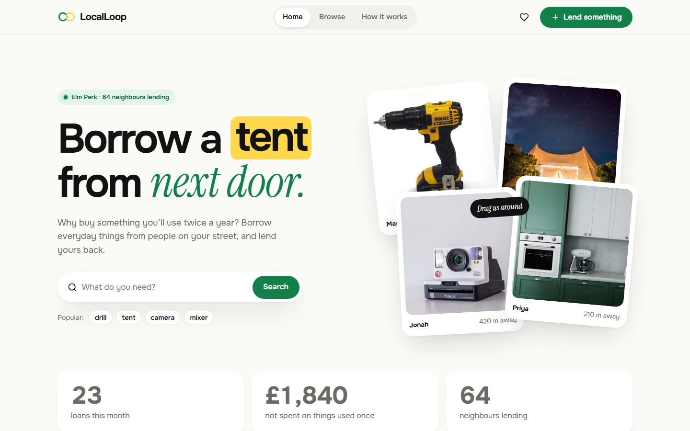

# LocalLoop

**Borrow from your neighbours.** LocalLoop is a neighbourhood sharing platform where people
lend, borrow and swap everyday things (drills, tents, cameras, the good blender) instead of
each buying their own.

> Live demo: [localloop-gamma.vercel.app](https://localloop-gamma.vercel.app) · Part of [my portfolio](https://ilia-rusia.vercel.app)



## Features

- Distinctive home page with a "noticeboard" of recent listings and a neighbourhood stats strip
- **Browse** with search (items, lenders, streets), category tabs, an "available now" filter and three sort orders.
  Filters live in the URL, so any view can be shared.
- Item cards with photography, availability tags, distance and deposit
- **Item detail pages** with condition, deposit, loan length, what's included and related items
- **Borrow requests** with date pickers, validation against the lender's rules and the item's
  availability, and a clear success state you can withdraw from
- **Favourites**, requests and your own listings on a "Saved" page with tabs
- **Lend something** form with inline validation and a live preview card
- Loading skeletons, empty states, toast feedback, a 404 page and an animated mobile menu
- Everything you do is kept in `localStorage`

## Built with

React 19 · Vite · React Router 7 · Context API · custom `useLocalStorage` hook ·
**Motion** (`motion/react`) for springs, layout animations and gestures · plain CSS · Lucide icons ·
photography from Unsplash

## Motion

Everything moves on springs: page transitions, cards that reflow when you filter, a draggable
stack of photo cards on the home page, sliding highlights in the nav and category chips, a
popping save heart, a self-drawing tick when a request is sent, and a listing preview that tilts
in 3D toward the pointer. `MotionConfig reducedMotion="user"` turns all of it off for people who
prefer reduced motion.

## Project structure

```
src/
  components/   Header, Footer, ItemCard, ItemImage, BorrowForm, AvailabilityTag, Toast
  context/      LoopContext: listings, favourites, requests (persisted)
  data/         items.js: sample listings and categories
  hooks/        useLocalStorage, useDocumentTitle
  pages/        Home, Browse, ItemDetail, Saved, Lend, NotFound
  styles/       global.css: design tokens and shared styles
  utils/        format.js: distances, dates, deposits
```

## Run locally

```bash
npm install
npm run dev        # http://localhost:5174
```

## Build for production

```bash
npm run build      # outputs to dist/
npm run preview    # serves the production build locally
```

## Deploy

Push this folder to its own GitHub repository, then import it on [Vercel](https://vercel.com).
Vite is detected automatically (build `npm run build`, output `dist`). `vercel.json` rewrites
all routes to `index.html`, so refreshing `/item/polaroid-now` works.

To reset the demo, clear the site's local storage in your browser's dev tools.

---

LocalLoop is a portfolio concept: the people, listings and neighbourhood are fictional.
